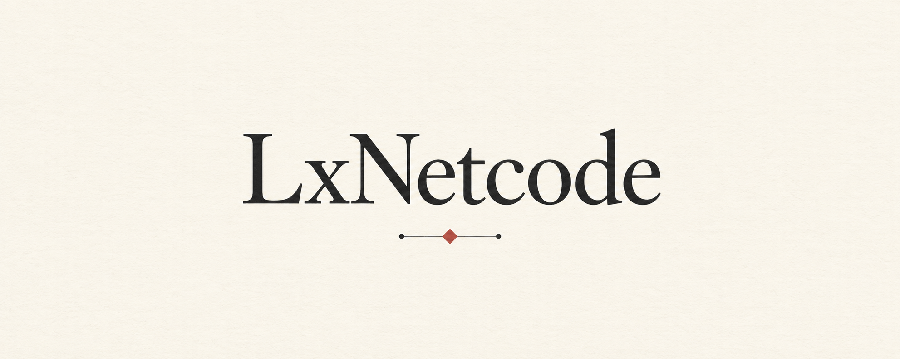

# LxNetcode



C# 游戏网络学习项目。由项目作者从零研究并手写包格式、协议、连接状态、可靠性及游戏网络功能；AI 的实现职责仅限于必要且可靠的原始 UDP Socket I/O 封装。

## 当前阶段

Unity 7000.0.0a10 开发工程与 UPM 源码包骨架已建立，并通过实际编辑器编译和本地包刷新检查。Socket 设计尚未批准；目前没有网络实现或网络测试，也没有发布 tag。

## 仓库结构

| 路径 | 用途 |
| --- | --- |
| `docs/` | 项目状态、组织决策和测试计划，随代码提交到 Git |
| `Unity/` | Unity 7000.0.0a10 开发与验证工程 |
| `Packages/com.counull.lxnetcode/` | UPM 源码包与纯 C# Runtime 程序集骨架 |
| `.agents/skills/` | 随仓库分发的项目技能 |
| `AGENTS.md` | AI 职责边界与协作规则 |

开发工程通过 `file:../../Packages/com.counull.lxnetcode` 消费仓库内同一份包源码。实际游戏项目以后通过 Unity Package Manager 的 Git URL 引用包，不需要先分发 DLL。包布局、同步方式和兼容基线见[组织决策](docs/ARCHITECTURE.md)。

## 打开工程

安装 Git LFS 后，在仓库根目录执行：

```powershell
git lfs install --local
git lfs pull
```

使用 Unity Hub 添加并打开 `Unity/`，选择 **7000.0.0a10**。当前 Standalone 配置为 .NET Standard 2.1、CoreCLR；Runtime asmdef 禁止 UnityEngine 引用。初始化检查命令与真实结果见[测试记录](docs/TESTING.md)。

图片、模型、音频等二进制资源由 `.gitattributes` 配置 LFS；源码、Unity YAML 与 `.meta` 保留为普通文本。现有封面已转入 LFS，未改写历史提交。

## 维护入口

从[文档索引](docs/README.md)进入维护文档；[项目状态](docs/STATUS.md)记录已完成事项和待确认项，[测试计划](docs/TESTING.md)区分计划与实际执行结果。

项目技能包括 `$lxnetcode-socket-workflow` 和 `$lxnetcode-socket-review`。技能位置采用 [OpenAI 官方仓库技能约定](https://learn.chatgpt.com/docs/build-skills#where-codex-loads-local-skills)。

Matt Pocock 工程技能已配置使用 GitHub Issues、默认 triage 标签和单上下文领域文档布局；配置文件位于 `docs/agents/`，由 `AGENTS.md` 引用。选择 GitHub 跟踪方式不代表已创建远程 Issue 或标签。

## 学习资料

资料用于理解概念与权衡，不构成授权 AI 实现上层网络栈。

- [Gaffer On Games — Game Networking](https://gafferongames.com/categories/game-networking/)
- [Gabriel Gambetta — Fast-Paced Multiplayer](https://gabrielgambetta.com/)
- [Valve — Source Multiplayer Networking](https://developer.valvesoftware.com/wiki/Source_Multiplayer_Networking)
